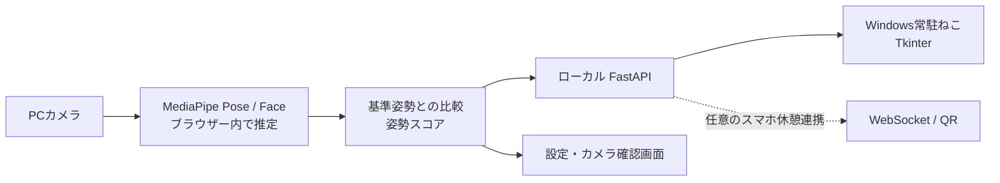

<div align="center">

# 🐈 ErgoPulse

**姿勢は、ねこにお任せ。**

PCカメラで姿勢の変化を捉えて、デスクトップのねこがお知らせ。  
悪い姿勢が続くと巨大化・増殖、設定によっては画面がねこでいっぱいに！

**Windows · Python · JavaScript · MediaPipe · JPHACKS 2026 プロトタイプ**

[はじめかた](#-30秒でわかる起動方法) · [デモの見どころ](#-デモの見どころ) · [技術構成](#-技術構成) · [JPHACKS向け紹介](README_JPHACKS.md)

</div>


> 画面例：カメラ未接続時の設定画面。公開用の画像にカメラ映像や個人情報は含めていません。**実際のねこ巨大化・全画面表示のデモ動画は今後追加予定**です。

## 💡 何ができる？

| 機能 | 体験 |
| --- | --- |
| **姿勢の変化を検知** | 顔と肩をカメラで推定し、本人の登録姿勢からの変化をスコア表示 |
| **デスクトップねこ** | Word・VS Codeなど、別アプリの上にも小さなねこを表示（Windows） |
| **姿勢に応じて巨大化・増殖** | 悪い姿勢が続くとねこが大きくなり、子ねこが最大2匹増える |
| **3秒で画面がねこまみれ** | *任意で有効化*すると、スコア80未満が連続約3秒で全画面にねこを表示 |
| **ねことふれあう** | 「ねこをリポップ」で「にゃ〜」風の音、「ねこをなでる」でゴロゴロ音とハート |
| **右側にカメラプレビュー** | 自分の映り方、基準登録の進捗、認識状態を確認できる |

**ねこまみれ中も閉じ込めない設計**：姿勢スコア80点以上を5秒連続で維持すると自動解除（猫のドアップでカウントダウン）。`Esc`／解除ボタンでも終了でき、最長30秒で自動解除します。*Windowsをロックしたり、キーボードを無効化したりするものではありません。*

## 🚀 30秒でわかる起動方法

**必要なもの：Windows PC、Webカメラ、Python 3.11以降。** 初回の依存関係インストールにはインターネット接続が必要です。

1. このリポジトリを **Code → Download ZIP** から取得し、「すべて展開」する。
2. フォルダー直下の **`ErgoPulse_START.bat`** をダブルクリックする（`start_windows.bat` でも可）。
3. 自動的に開く `http://localhost:8000` で、初回のみカメラを許可する。
4. カメラに顔・両肩が入るように座り、約2秒間、楽な姿勢で基準登録する。
5. 設定を変えたら、VS CodeやWordなど、いつもの作業に戻る。

> **うまくいかないとき**：`python --version` / `py --version` でPythonを確認。画面が古い、カメラが0%のまま、ねこが出ない場合は [トラブルシューティング](docs/TROUBLESHOOTING.md) を参照してください。

**終了**：起動したコマンドプロンプトで `Ctrl + C`。起動中はそのウィンドウを閉じず、ブラウザーも開いたままにしてください。

## 🎬 デモの見どころ

1. 良い姿勢で約2秒間の基準登録を行う。
2. 少し前かがみになり、姿勢スコアとねこの変化を観察する。
3. **「ねこが2匹で画面全体を覆う」設定を有効化**し、スコア80未満の状態を約3秒続ける。
4. 画面がねこで埋まり、80点以上の姿勢を5秒維持するか `Esc` を押すと解除される。
5. 「🐈 ねこをリポップ」「♡ ねこをなでる」で鳴き声とハートを体験する。

全画面表示は任意設定です。**復帰には80点以上を連続5秒維持**する必要があります（カウント中は猫のドアップ表示）。デモ前に編集中のファイルを保存し、解除方法を確認してください。

[全画面ねこ・復帰ルールの詳細](docs/POSTURE_PAUSE.md)  
📋 [撮影用の短いデモ手順](docs/DEMO.md)

## 🧠 技術構成



- **姿勢推定**：`frontend/sensing.js`、`frontend/vision-worker.js`
- **UI / ふれあい**：`frontend/index.html`、`frontend/coach.js`、`frontend/cat-audio.js`
- **ローカルAPI**：`backend/main.py`
- **常駐ねこ・全画面ねこ表示**：`backend/desktop_guard.py`
- **動作テスト**：`tests/`

詳しくは [設計とデータフロー](docs/ARCHITECTURE.md)。

### リポジトリ構成

```text
ErgoPulse/
├── README.md                 # まず読むファイル
├── ErgoPulse_START.bat       # Windows起動（推奨）
├── start_windows.bat         # サーバー＋デスクトップねこ
├── start_quiet_windows.bat   # ねこを手動起動する予備手段
├── backend/                  # FastAPI・Tkinter・音声素材
├── frontend/                 # UI・姿勢推定・学習済みモデル
│   ├── models/               # MediaPipeモデル（ローカル実行用）
│   └── vendor/               # 第三者ライブラリとライセンス
├── tests/                    # Python・JavaScriptテスト
├── docs/                     # 詳細資料と画像
└── .github/workflows/        # GitHub Actionsの自動テスト
```

## 🔒 プライバシーと制約

- カメラ映像は**利用者のブラウザーで推定**し、サーバーや外部サービスには映像を送信しません。Windowsのねこへ渡すのは姿勢スコアなどの短時間の数値・状態フラグです。
- 設定はブラウザー内に保存します。任意の利用状況記録は初期状態でオフです。
- スマホのQR連携は**オプション**で、同じLAN上のPCサーバーとの通信を利用します。一般公開サーバーとしての運用は想定していません。
- 顔・肩の相対的な位置から推定する**姿勢変化の目安**であり、猫背の医学的診断や姿勢改善効果を保証するものではありません。
- バックグラウンドでのカメラ解析・画面最前面表示はOSやブラウザーによって変わるため、**Windows実機での最終動作確認が必要**です。

## 🧪 開発者向け

```bash
python -m pip install -r backend/requirements-dev.txt
python -m pytest tests/test_relay.py tests/test_desktop_cat.py -q
```

```bash
# Node.js 20以上。各テストを実行
node tests/test_calibration.cjs
node tests/test_cat_audio.cjs
node tests/test_sensing.cjs
node tests/test_workflow.cjs
node tests/test_qr.cjs
node tests/test_insights.cjs
node tests/test_posture_guard.cjs
```

プッシュ時には [.github/workflows/ci.yml](.github/workflows/ci.yml) がテストを実行します。  
[開発ガイド](docs/DEVELOPMENT.md) · [使用ライブラリと権利表記](docs/THIRD_PARTY.md)

## 🗺️ 今後の展望

- 姿勢推定の精度評価・誤判定を抑える信頼度処理
- 長時間使っても邪魔になりにくい通知・ねこの動作パターン
- 配布と起動の簡単化（Windows実行ファイル化など）
- ユーザーテストによる使いやすさ・介入負担の評価

## 📚 ドキュメント

| ドキュメント | 内容 |
| --- | --- |
| [JPHACKS提出用説明](README_JPHACKS.md) | 背景、製品説明、特長、独自技術を提出フォーマットで記載 |
| [設計とデータフロー](docs/ARCHITECTURE.md) | モジュールの役割、姿勢判定、停止条件 |
| [起動・エラー対策](docs/TROUBLESHOOTING.md) | Python・古い画面・カメラが0%・ねこが出ない場合 |
| [デモ手順](docs/DEMO.md) | ハッカソン向けの短い実演シナリオ |
| [開発ガイド](docs/DEVELOPMENT.md) | テストと開発環境 |
| [第三者素材](docs/THIRD_PARTY.md) | MediaPipe・モデル・効果音など |
| [GitHubへの公開手順](docs/PUBLISHING.md) | ZIPからの公開、README画像・Actionsの確認 |

## ライセンス

この配布ZIPには独自ソースコード用のLICENSEを同梱していません。既存リポジトリを更新する場合は、そのリポジトリのLICENSEを保持してください。第三者ライブラリ・モデルは各配布元の利用条件に従います。詳しくは [第三者素材と利用条件](docs/THIRD_PARTY.md) を参照してください。

---

<sub>ErgoPulse — ねこはかわいく、姿勢への気づきはさりげなく。JPHACKS向けプロトタイプ。</sub>
