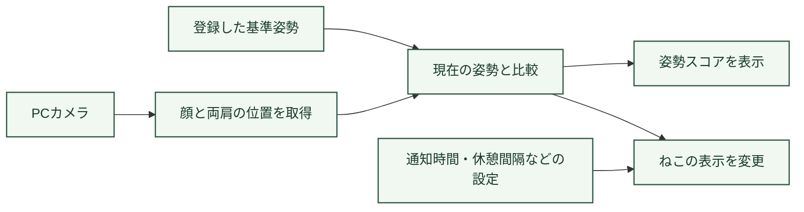
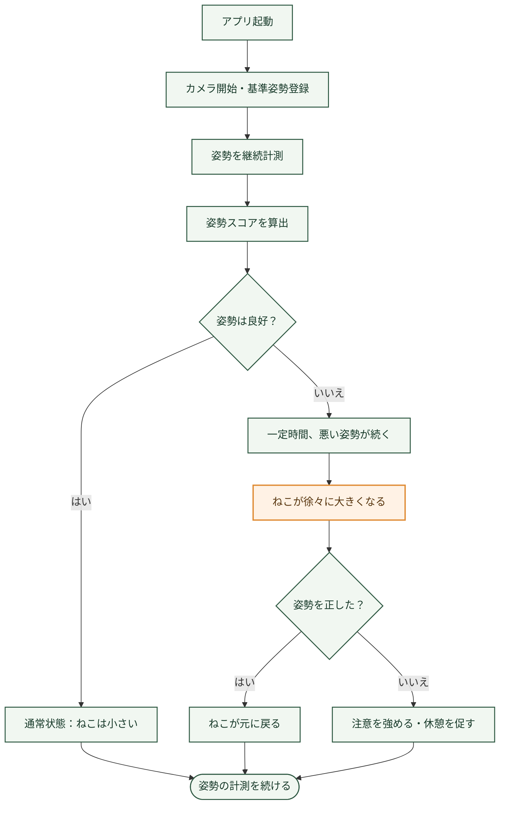

# ErgoPulse（エルゴパルス）

**姿勢は、ねこにお任せ。**

ErgoPulseは、パソコン作業中の姿勢をカメラで確認し、デスクトップ上のねこで姿勢の乱れを知らせるアプリです。

姿勢が崩れた状態が続くと、ねこが徐々に大きくなります。姿勢を直すと元の大きさに戻ります。作業を止めて警告を確認するのではなく、ねこの変化から自然に気づけるようにしました。

## 製品概要

### 背景（製品開発のきっかけ・課題）

パソコンで作業をしていると、いつの間にか背中が丸まったり、画面に顔を近づけたりすることがあります。姿勢を正そうと思っても、作業に集中している間ずっと意識し続けるのは難しいと感じました。

そこで考えたのが、音やポップアップで何度も警告するのではなく、普段の作業画面の中で姿勢の変化に気づける仕組みです。作業の邪魔になりにくく、使い続けたくなるように、ねこのキャラクターを組み合わせました。

### 製品説明

 **姿勢改善 × Tech**
アプリを起動したら、カメラに顔と両肩が映るように座り、基準となる姿勢を登録します。その後は姿勢を継続して計測し、現在の姿勢をスコアで表示します。

悪い姿勢が一定時間続いた場合は、画面上のねこが徐々に大きくなります。姿勢を戻すと、ねこも元の大きさに戻ります。

通知を出すまでの時間や休憩間隔、画面の表示倍率などは設定画面から変更できます。ねこをほかのアプリの上に表示する設定も用意しています。

### 特長

#### 1. ねこの大きさで姿勢を知らせる

姿勢が崩れても、すぐに大きな警告を出すことはしません。一定時間続いたときにねこが大きくなり、姿勢を正せば小さく戻ります。ねこの反応と自分の姿勢がつながっているので、見たときに何をすればよいか分かるようにしました。

#### 2. 普段の作業を続けながら使える

ねこはデスクトップ上に表示されるため、姿勢を確認するたびに別のアプリを開く必要はありません。通知までの時間を変更できるので、作業の内容に合わせて調整できます。

#### 3. 注意の仕方を調整できる

姿勢を直すまでの時間や、注意を閉じた回数を参考に、知らせ方を調整する仕組みを取り入れています。一律の通知ではなく、使う人に合った注意の仕方を考えました。

#### 4. 休憩や画面との距離にも気づける

姿勢の乱れだけでなく、長時間作業しているときの休憩や、画面に顔を近づけすぎた場合にも注意を促します。

### システム構成

カメラで取得した情報を基準姿勢と比較し、姿勢スコアとねこの表示に反映します。

### 姿勢検知から通知までの流れ

姿勢が良い間は通常表示のまま計測を続けます。姿勢が崩れた場合も、一定時間続くまでは通知せず、姿勢を正せばねこは元に戻ります。

### 解決できること

- 作業に集中していても、ねこの変化から姿勢の乱れに気づける。
- 警告音で作業を中断せずに、姿勢を直すきっかけを作れる。
- ねこの反応を楽しみながら、姿勢を意識する習慣をつけやすくなる。
- 休憩のタイミングや、画面との距離にも気を配れる。

### 今後の展望

現在の仕組みをもとに、正面と横の2方向から姿勢を確認できるようにしたいと考えています。前かがみや体の傾きをより詳しく捉えることが目的です。

また、ねこだけでなく、画面の端を少し曇らせるなど、作業への影響が少ない知らせ方も検討しています。

### 注力したこと（こだわり）

一番意識したのは、姿勢の改善を強制するのではなく、利用者自身が気づいて直せるようにすることです。ねこが急に大きくなるのではなく徐々に変化すること、通知までの時間を選べることなど、作業中に使うことを前提に考えました。

## 開発技術

### 活用した技術

#### デバイス

- Windows PC
- PCカメラ

#### 主な機能

- カメラを使った姿勢の計測
- 基準姿勢の登録と姿勢スコアの表示
- デスクトップ上のねこの表示
- 通知までの時間・休憩間隔・表示倍率の設定

※使用したプログラミング言語やライブラリ名は、コードの確認後に追記します。

### 独自技術

#### 姿勢と連動するキャラクター表示

姿勢の状態を数値だけで伝えるのではなく、ねこの大きさに反映させました。姿勢を直すとねこも戻るため、利用者の行動がそのまま画面に表れます。

#### 利用者の反応に応じた通知

姿勢を直すまでの時間や通知を閉じた回数を参考に、注意の仕方を調整する仕組みを設けています。

