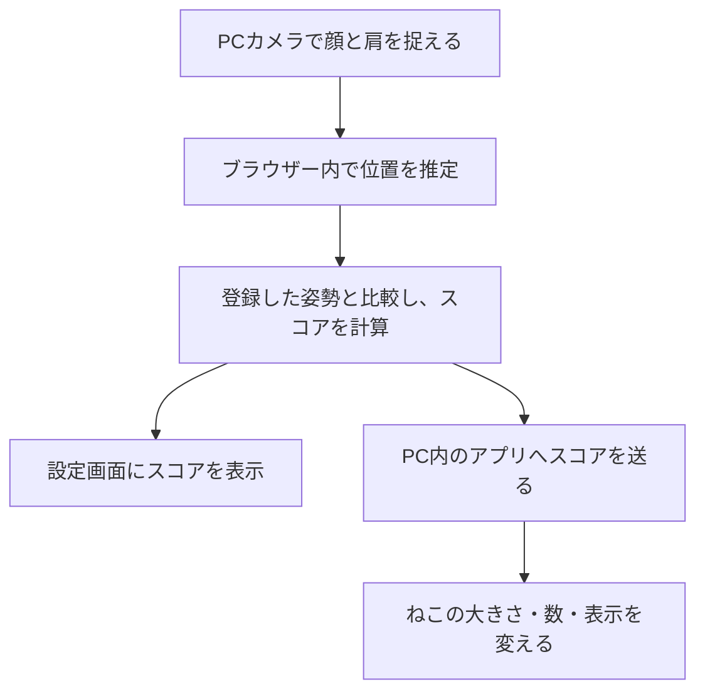

# ErgoPulse（エルゴパルス）

**作業中の姿勢の変化を、デスクトップのねこが知らせるアプリです。**

パソコンで作業していると、気づかないうちに前かがみになったり、顔が画面に近づいたりします。ErgoPulseはPCカメラでその変化を捉え、画面上のねこの大きさや数を変えて知らせます。

ねこはWordやVS Codeなどの上にも表示されるので、いつものアプリで作業しながら使えます。必要なのはWindows PCとWebカメラです。


*カメラ未接続時の画面例です。実際にねこが動く様子は、今後デモ動画で紹介する予定です。*

## なぜ作ったのか

作業に集中している間、自分の姿勢を意識し続けるのは難しいものです。一方で、何度も警告が出ると作業の邪魔になります。

そこで、普段は小さなねこをデスクトップに表示し、姿勢が崩れたときにねこの様子が変わる仕組みにしました。数字や警告だけで知らせるよりも、自然に姿勢を見直すきっかけになればと考えています。

## ねこはどう変わる？

| 場面 | 画面で起こること |
| --- | --- |
| 普段の作業中 | デスクトップに小さなねこが表示される |
| 姿勢が崩れた状態が続く | ねこが大きくなり、子ねこが最大2匹増える |
| 「全画面表示」を有効にしている場合 | 姿勢スコア80未満が約3秒続くと、画面がねこでいっぱいになる |
| 「ねこをリポップ」を押す | ねこを再表示し、「にゃ〜」風の音が鳴る |
| 「ねこをなでる」を押す | ゴロゴロ音とハートの演出が出る |

音は音量調整とミュートができます。全画面表示は、使いたい場合だけ設定で有効にします。

### 画面がねこでいっぱいになったら

**姿勢スコア80以上を5秒間保つと、元の画面に戻ります。** 復帰までのカウントダウンも表示されます。

すぐに作業へ戻りたい場合は、次の方法でも解除できます。

- `Esc`キーを押す
- 解除ボタンを押す
- 30秒の自動解除を待つ

Windows自体をロックする機能ではありません。

## 使い方

### 用意するもの

| 必要なもの | 補足 |
| --- | --- |
| Windows PC | デスクトップのねこを表示するために使用 |
| Webカメラ | PC内蔵カメラでも利用可能 |
| Python 3.11以降 | アプリの起動に使用 |
| インターネット接続 | 初回に必要なライブラリをインストールするために使用 |

### 起動から利用まで

1. GitHubの **「Code」→「Download ZIP」** からダウンロードし、**「すべて展開」** します。
2. 展開したフォルダーの **`ErgoPulse_START.bat`** をダブルクリックします。
3. 自動で開く `http://localhost:8000` で、カメラの使用を許可します。
4. 顔と両肩がカメラに入るように座り、基準にしたい楽な姿勢を約2秒保ちます。
5. 基準の登録が終わったら、ブラウザーと起動時の黒い画面を開いたまま、普段の作業に戻ります。

設定画面の右側にはカメラ映像が表示されます。顔や肩が映っているか、基準の登録が進んでいるかを確認できます。

**終了するときは、起動時の黒い画面（コマンドプロンプト）で `Ctrl + C` を押してください。**

起動しない、カメラの認識が進まない、ねこが出ない場合は、[トラブルシューティング](docs/TROUBLESHOOTING.md)を確認してください。

## 姿勢を検知する仕組み

最初に登録した姿勢を基準に、鼻と肩の位置関係や、画面に映る顔の大きさの変化を調べます。その変化を姿勢スコアにして、ねこの表示に反映します。



**スコアは、登録した姿勢からの変化を示す目安です。** 背中の角度や画面までの距離を正確に測るものではなく、医学的に姿勢を診断するものでもありません。

### カメラ映像の扱い

カメラ映像の解析は、利用者のブラウザー内で行います。映像をサーバーや外部サービスへ送信せず、PC内のねこ表示用アプリには、姿勢スコアなどの数値と状態だけを渡します。

設定はブラウザー内に保存します。任意の利用状況の記録は、初期状態ではオフです。

## デモで試すこと

| 順番 | 操作 | 確認すること |
| --- | --- | --- |
| 1 | 基準にしたい姿勢を約2秒保つ | 基準の登録が完了するか |
| 2 | 少し前かがみになる | スコアとねこの様子が変わるか |
| 3 | 全画面表示の設定を有効にし、スコア80未満の状態を約3秒続ける | 画面がねこでいっぱいになるか |
| 4 | 姿勢を戻し、スコア80以上を5秒保つ | カウントダウン後に解除されるか |
| 5 | 「ねこをリポップ」「ねこをなでる」を押す | 音やハートの演出が出るか |

全画面表示は、設定画面の **「ねこが2匹で画面全体を覆う」** から有効にします。実演前に編集中のファイルを保存し、`Esc`で解除できることも確認してください。

[詳しいデモ手順](docs/DEMO.md) ／ [全画面表示と解除条件](docs/POSTURE_PAUSE.md)

## 使用技術

| 役割 | 技術 | 主なファイル |
| --- | --- | --- |
| 設定画面・カメラ表示 | HTML / CSS / JavaScript | `frontend/index.html`、`frontend/coach.js` |
| 顔・肩の位置推定 | MediaPipe Pose / Face Landmarker | `frontend/sensing.js`、`frontend/vision-worker.js` |
| PC内でのデータ受け渡し | Python / FastAPI | `backend/main.py` |
| デスクトップのねこ表示 | Python / Tkinter | `backend/desktop_guard.py` |
| ふれあい操作の音 | JavaScript・音声ファイル | `frontend/cat-audio.js` |
| 自動テスト | pytest / Node.js / GitHub Actions | `tests/`、`.github/workflows/ci.yml` |

追加のマイコンや専用センサーは使っていません。任意の機能として、同じLANに接続したスマートフォンへ休憩を案内する仕組みもあります。

詳しくは[設計とデータフロー](docs/ARCHITECTURE.md)を参照してください。

## ファイルの見方

| ファイル・フォルダー | 内容 |
| --- | --- |
| `README.md` | アプリの概要と使い方（このページ） |
| `README_JPHACKS.md` | JPHACKS提出向けの説明 |
| `ErgoPulse_START.bat` | Windows用の起動ファイル |
| `start_windows.bat` | サーバーとねこ表示を起動する処理 |
| `start_quiet_windows.bat` | ねこを手動起動する予備手段 |
| `backend/` | PC内のサーバー、ねこの表示、音声素材 |
| `frontend/` | 設定画面、姿勢推定、モデル、関連ライブラリ |
| `docs/` | 詳細な説明とREADME用の画像 |
| `tests/` | PythonとJavaScriptのテスト |
| `.github/workflows/` | GitHub上でテストを実行する設定 |

## 今後取り組みたいこと

- カメラの角度や座る位置が変わっても、判定を安定させる
- 長時間の作業でも邪魔になりにくい、ねこの動きや通知方法を調べる
- Pythonの準備なしで起動できるよう、Windows用の実行ファイルにまとめる
- 実際に使ってもらい、気づきやすさや作業への影響を確認する

現在は試作段階です。姿勢改善の効果はまだ検証していません。また、別アプリを操作している間のカメラ解析や、ねこの最前面表示は、Windows実機で確認する必要があります。

## 開発・テスト

Python側のテストは、次のコマンドで実行できます。

```bash
python -m pip install -r backend/requirements-dev.txt
python -m pytest tests/test_relay.py tests/test_desktop_cat.py -q
```

JavaScript側のテストには、Node.js 20以上を使います。

```bash
node tests/test_calibration.cjs
node tests/test_cat_audio.cjs
node tests/test_sensing.cjs
node tests/test_workflow.cjs
node tests/test_qr.cjs
node tests/test_insights.cjs
node tests/test_posture_guard.cjs
```

GitHubへのプッシュ時にも、[GitHub Actions](.github/workflows/ci.yml)でテストを実行します。

## 関連資料

| 資料 | 内容 |
| --- | --- |
| [JPHACKS提出用説明](README_JPHACKS.md) | 開発の背景、特長、独自に実装した部分 |
| [設計とデータフロー](docs/ARCHITECTURE.md) | 各機能の役割とデータの流れ |
| [トラブルシューティング](docs/TROUBLESHOOTING.md) | 起動やカメラ認識で困ったときの対処 |
| [開発ガイド](docs/DEVELOPMENT.md) | 開発環境とテスト方法 |
| [第三者素材と利用条件](docs/THIRD_PARTY.md) | ライブラリ、モデル、音声素材の扱い |
| [GitHubへの公開手順](docs/PUBLISHING.md) | ファイルのアップロード方法 |

## ライセンス

この配布ZIPには、独自ソースコード用の`LICENSE`を同梱していません。既存のリポジトリを更新する場合は、そのリポジトリの`LICENSE`を保持してください。

第三者ライブラリやモデルには、それぞれの配布元の利用条件が適用されます。[第三者素材と利用条件](docs/THIRD_PARTY.md)にまとめています。
